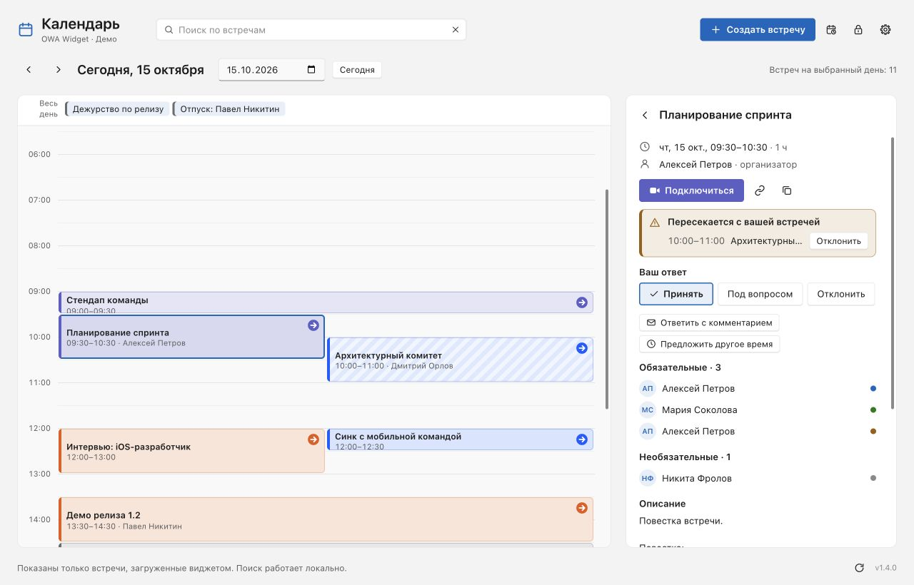
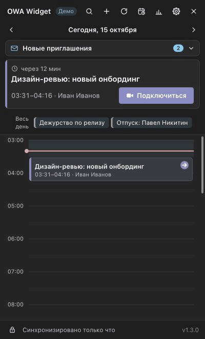
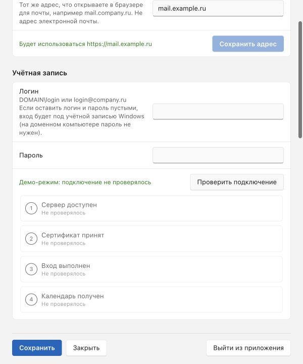
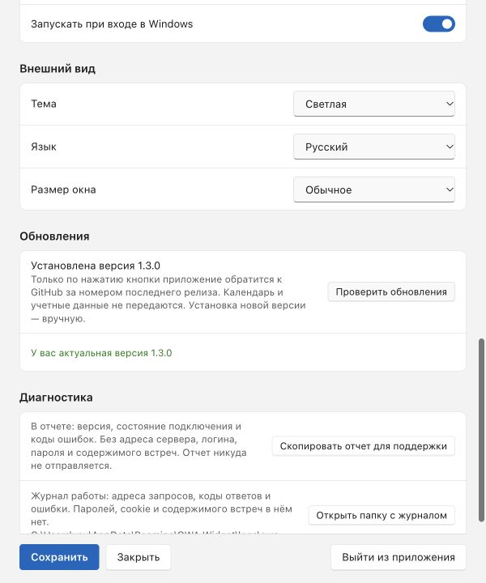

<h1 align="center">OWA Widget</h1>

<p align="center">Русский · <a href="README.en.md"><strong>English documentation</strong></a></p>

<p align="center">
  <a href="https://github.com/dmitrbrvsk/win-owa-widget/actions/workflows/build.yml?query=branch%3Amaster"></a>
  <a href="https://github.com/dmitrbrvsk/win-owa-widget/releases/latest"></a>
  <a href="LICENSE"></a>
</p>

<p align="center"><strong>Ближайшая встреча — рядом с часами Windows.</strong></p>
<p align="center">Календарь Exchange в трее: расписание на день, напоминания<br>и подключение к звонку без открытия Outlook.</p>

<p align="center">
  <a href="https://github.com/dmitrbrvsk/win-owa-widget/releases/latest"><strong>Скачать для Windows →</strong></a>
  &nbsp; · &nbsp; <a href="#быстрый-старт">Как подключиться</a>
  &nbsp; · &nbsp; <a href="docs/GUIDE.md">Руководство и FAQ</a>
  &nbsp; · &nbsp; <a href="CHANGELOG.md">История изменений</a>
</p>

<p align="center"><sub>Windows 10/11 · x64 и ARM64 · Русский / English · Без прав администратора</sub></p>

**Совместимость:** корпоративный Exchange on-premises с OWA. Microsoft 365 / Exchange Online, современная авторизация OAuth и отдельные SSO-порталы не поддерживаются.

**Степень проверки:** CI запускает тесты, собирает приложение и проверяет открытие окон на Windows. Вход, операции EWS и уведомления Windows требуют отдельной проверки в реальной рабочей среде — [подробности и ограничения](docs/GUIDE.md#общие-вопросы).

<p align="center">
  
</p>

OWA Widget живет в области уведомлений и дает быстрый доступ к рабочему календарю. Посмотрите, что дальше, ответьте на приглашение или найдите общее время с коллегами — в компактном окне у трея. Почту приложение не читает.

<a id="в-работе" name="в-работе"></a>

## Возможности

### 01 / Посмотреть день и подключиться к встрече

Ближайшая встреча всегда сверху, ниже — таймлайн дня. Пересечения видны рядом, текущий момент отмечен красной линией. Чтобы найти нужную встречу, нажмите **Ctrl+F** или **/**; кнопка **«Подключиться»** откроет ссылку на звонок в браузере.

<p align="center">
  
</p>

Иконка в трее показывает минуты до встречи или до ее конца. Перед началом появляется напоминание: уведомление Windows с кнопками либо отдельное окно приложения.

<details>
<summary><strong>Развернуть календарь в отдельное окно</strong></summary>

Пункт **«Календарь…»** в меню трея или кнопка разворачивания в виджете открывают большое окно: расписание слева, карточка выбранной встречи справа. Окно можно уменьшить или перенести на другой монитор; его закрытие оставляет приложение в трее. Поиск и выбор даты работают среди уже загруженных встреч.

<p align="center">
  
</p>

</details>

### 02 / Разобраться с приглашениями

Новые приглашения собраны в одном месте. Примите встречу, ответьте с комментарием или предложите другое время. Если приглашение пересекается с уже принятой встречей, приложение покажет конфликт. Личную заметку можно оставить прямо в карточке.

<p align="center">
  
  &nbsp;
  
</p>

Комментарий и предложение времени отправляются организатору после подтверждения в системном окне. Предложение приходит текстом в ответе на приглашение; время в календаре организатора само не меняется. Личные заметки остаются на вашем компьютере.

### 03 / Найти время для своей команды

Добавьте коллег из адресной книги Exchange или выберите сохраненную группу «Моя команда», укажите длительность и посмотрите сетку занятости. OWA Widget предложит подходящие интервалы. Выберите один — время и участники перейдут в форму новой встречи.

<p align="center">
  
</p>

Можно создавать повторяющиеся встречи, переносить и отменять свои встречи. Перед рассылкой приглашений или изменением встречи с участниками приложение показывает системное подтверждение с получателями и деталями.

### 04 / Скрыть данные перед демонстрацией экрана

Нажмите замок внизу виджета: во всех его окнах скроются названия встреч, имена, адреса и заметки. Время и занятость останутся видны. Повторное переключение вернет обычный календарь.

<p align="center">
  
</p>

<details>
<summary><strong>Подключение, обновления и отчет для поддержки</strong></summary>

Проверка подключения показывает четыре этапа: сервер → сертификат → вход → календарь. Безопасный отчет можно просмотреть и скопировать из настроек. Проверка обновлений обращается к GitHub только по нажатию кнопки; скачивание и установка остаются ручными.

<p align="center">
  
  &nbsp;
  
</p>

</details>

<details>
<summary><strong>Еще одна полезная вещь: статистика встреч</strong></summary>

Посмотрите, сколько времени занимают встречи за неделю или месяц, какие дни загружены сильнее и с кем вы встречаетесь чаще всего.

<p align="center">
  
</p>

</details>

<sub>Снимки и анимации сняты с реального интерфейса в браузерном демо-режиме. Все встречи и участники вымышлены; подключения к Exchange и отправки приглашений во время съемки нет. Оформление шрифтов и системных окон в Windows может отличаться.</sub>

## Быстрый старт

1. **[Скачайте последний релиз](https://github.com/dmitrbrvsk/win-owa-widget/releases/latest)** и выберите файл под свой компьютер:

   | Файл | Для чего |
   |---|---|
   | `OWA-Widget-Setup-<версия>.exe` | Установка на Windows x64; работает и на ARM64 в эмуляции |
   | `OWA-Widget-Setup-<версия>-arm64.exe` | Установка на Windows ARM64 |
   | `OWA-Widget-<версия>-portable-x64.zip` | Запуск без установки: распакуйте и откройте `OWA Widget.exe` |

2. **Откройте приложение и найдите иконку в трее.** На Windows 11 она может быть под стрелкой **^**. Установка не требует прав администратора.
3. **Укажите сервер OWA в настройках**, например `mail.company.ru` — адрес сервера, а не адрес почты. По умолчанию указан `owa.alfabank.ru`: замените его на сервер своей компании.
4. **Подключитесь.** Оставьте логин и пароль пустыми для входа под учетной записью Windows или введите данные, которыми входите в OWA. При необходимости подключите корпоративный VPN.

Установщик пока не подписан Authenticode, поэтому Windows SmartScreen может показать предупреждение. Перед запуском сверьте `SHA256SUMS.txt` из релиза и происхождение сборки: [команды проверки](SECURITY.md#как-проверить-скачанный-файл).

**Совместимость:** корпоративный Exchange с OWA, встроенный вход Windows (Kerberos / NTLM) или форма OWA. Exchange Online / Microsoft 365 и отдельные порталы единого входа (ADFS / Azure AD) не поддерживаются. Создание встреч и поиск занятости требуют доступного EWS; ограничения и текущая степень проверки описаны в [руководстве](docs/GUIDE.md#общие-вопросы).

## Ваш календарь — на вашем сервере

| Данные | Как с ними работает приложение |
|---|---|
| Встречи и участники | Обращается только к настроенному серверу Exchange по HTTPS |
| Пароль | Шифруется средствами Windows (DPAPI) и привязывается к серверу |
| Локальный кеш и заметки | Хранятся зашифрованными; заметки не отправляются на сервер |
| Поиск по встречам | Работает локально среди уже загруженных встреч |
| Группы участников | Хранятся локально с шифрованием, отдельно для каждого аккаунта |
| Проверка обновлений | Только по кнопке в настройках: запрос к GitHub без календаря и учетных данных; установка вручную |
| Телеметрия | Отсутствует |

Смена сервера, доверие внутреннему сертификату и операции с рассылкой приглашений защищены системными подтверждениями. Подробности — в [модели безопасности](SECURITY.md).

Режим приватности включается кнопкой с замком в виджете, в настройках или меню трея: во всех окнах остаются время и занятость, а названия, имена и заметки скрываются. Включайте его перед демонстрацией экрана.

При настройке подключения видны четыре этапа: сервер → сертификат → вход → календарь. Для обращения в поддержку можно скопировать безопасный технический отчет и посмотреть его содержимое в настройках.

## Локальный MCP

Начиная с версии 1.5.0 доступна базовая интеграция с локальными MCP-клиентами. По умолчанию доступ выключен; включение требует системного подтверждения, названия встреч разрешаются отдельно. Режим приватности скрывает названия и для MCP.

Клиент читает только уже загруженные встречи и не меняет календарь. Подключенный ИИ-клиент может передать полученные данные своему провайдеру: учитывайте правила компании. Для адаптера нужен отдельный Node.js 24.22+ в ветке 24.x. [Подключение и ограничения](docs/MCP.md).

## Полезные ссылки

- **[Руководство и FAQ](docs/GUIDE.md)** — возможности, уведомления, обновление и ответы на частые вопросы.
- **[Решение проблем](docs/GUIDE.md#если-что-то-не-работает)** — подключение, сертификаты, VPN и диагностика.
- **[Сообщить о проблеме](https://github.com/dmitrbrvsk/win-owa-widget/issues)** — приложите версию приложения и описание проблемы; не публикуйте пароли и данные встреч.
- **[Все релизы](https://github.com/dmitrbrvsk/win-owa-widget/releases)** — установщики, portable-архивы и контрольные суммы.

## Благодарности

Спасибо [@ilyabazhenov](https://github.com/ilyabazhenov), автору [mac-owa-widget](https://github.com/ilyabazhenov/mac-owa-widget), за идею и вдохновение!

Его виджет календаря Exchange для macOS стал отправной точкой этого проекта. Идея быстрого доступа к встречам из строки меню легла в основу аналога для Windows. Windows-версия написана заново на Electron, React и TypeScript.

## Для разработчиков

Для разработки: Node.js **24.22.0 LTS** и Yarn **4.18.1** через Corepack. Версии закреплены в `.nvmrc`, `.node-version` и `package.json`; CI использует тот же Node.js.

Electron + React + TypeScript. Главный процесс отвечает за Exchange, хранение данных, трей и окна; интерфейс получает данные через preload/IPC. Общая логика календаря отделена от Electron.

```bash
nvm install
nvm use
corepack enable
yarn install --immutable
yarn setup:electron
yarn dev:demo     # вымышленные встречи, Exchange не нужен
yarn typecheck
yarn lint
yarn test
yarn build
```

`yarn dev` запускает приложение с настоящим аккаунтом, `yarn dist` собирает установщики Windows и portable-архив. Для каждой версии нужен отдельный [текст изменений](docs/releases/README.md). Подробности: [устройство проекта и выпуск](docs/GUIDE.md#для-разработчиков), [ручные тест-кейсы](docs/TEST-CASES.md).

Правила проверки и форматирования кода: [docs/LINTING.md](docs/LINTING.md).
